# BossAnalyze - BOSS 直聘数据分析系统

[](https://www.oracle.com/java/)
[](https://spring.io/projects/spring-boot)
[](https://spring.io/projects/spring-cloud)
[](https://vuejs.org/)
[](https://nodejs.org/)
[](https://spark.apache.org/)
[](https://www.scala-lang.org/)
[](https://maven.apache.org/)
[](LICENSE)
[](https://deepwiki.com/DavidHLP/BossAnalyze)

For local startup and connectivity checks, see [Local Development](docs/local-development.md).
Current local acceptance and remaining external gates are recorded in the
[non-BOSS delivery report](docs/operations/non-boss-delivery-20261109.md).

The frontend is being rebuilt on Nuxt 4 and shadcn-vue preset `a2lQlAlu` with pointer
styles enabled. The API layer lives under `frontend/app/`; login, the console, management
pages, dashboards and read-only recruitment analytics are implemented. Resume editing and
other unbuilt routes remain outside the current UI. The screenshots below document the
previous frontend. See the [API handoff](docs/frontend-api/README.md)
and [frontend README](frontend/README.md) for the current state. Backend services and stored data
are unchanged by this frontend work.

## 📌 目录

1. [项目介绍](#-项目介绍)
2. [技术栈](#-技术栈)
3. [项目结构](#-项目结构)
4. [项目展示](#-项目展示)
5. [项目计划](#-项目计划)

## 📋 项目介绍

BossAnalyze 是一个基于微服务架构的 BOSS 直聘招聘数据分析与可视化平台，采用 Spring Cloud 生态构建，旨在为求职者、招聘方和数据分析师提供深度的招聘市场洞察。通过分布式爬虫系统爬取、清洗和分析 BOSS 直聘的招聘数据，本系统能够实时展示不同职位、地区、行业的薪资分布、技能需求以及市场趋势。

### ✨ 核心功能

- **📊 招聘分析**：城市、职位、薪资及学历/经验坐标分析，保留真实空数据状态。
- **📈 访问看板**：展示已生成的日志快照；尚无快照时明确显示空态，不填充演示指标。
- **🔒 账户与权限**：登录、会话撤销及用户、角色、菜单的后端授权管理。
- **📄 简历 API 与文件存储**：MongoDB 简历持久化及 RustFS 图片上传/读取；当前简历编辑 UI 仍是重建占位。
- **🤖 AI 接口**：Python CommandCode Jev 证据提取和多维匹配，具备内部认证、来源/字节校验及部分结果处理；真实模型质量尚未批准，自动调度与写回关闭。

技能图谱、薪资预测及完整智能推荐是后续产品方向，不属于当前已验收能力。固定 Jev 1.14.0 当前没有 ZDR 上游；详见[本地启动与 AI 边界](docs/local-development.md#python-ai-service-and-privacy-boundary)。

### 🎯 目标用户

| 用户群体      | 核心价值                                 |
| ------------- | ---------------------------------------- |
| 👨‍💼 求职者     | 掌握市场薪资水平，优化求职策略           |
| 🏢 企业 HR    | 了解行业人才分布，制定有竞争力的招聘方案 |
| 🎓 教育机构   | 把握市场需求，优化课程设置               |
| 📊 市场分析师 | 获取深度洞察，支持决策分析               |

### 🚀 项目特色

- **☁️ 云原生架构**：基于 Spring Cloud 的微服务解决方案
- **⚡ 高性能处理**：Apache Spark 驱动的大规模数据处理
- **🔒 安全可靠**：完善的身份认证与授权机制
- **📱 响应式设计**：适配 PC

## 🛠️ 技术栈

### 后端技术

| 技术栈           | 版本         | 说明                           | 应用场景                                                         |
| ---------------- | ------------ | ------------------------------ | ---------------------------------------------------------------- |
| **Java**         | 17+          | 主要开发语言                   | 后端服务开发                                                     |
| **Spring Boot**  | 3.4.5        | 应用框架，简化 Spring 应用开发 | 快速构建独立运行、生产级别的 Spring 应用                         |
| **Spring Cloud** | 4.2.1        | 微服务框架                     | Consul 服务注册与发现、OpenFeign 服务调用、LoadBalancer 负载均衡 |
| **Apache Spark** | 4.0.0        | 大数据处理框架                 | 处理大规模 BOSS 直聘数据、用户行为分析、实时计算                 |
| **MySQL**        | 8.0+         | 关系型数据库                   | 存储用户账户、权限、系统配置等核心结构化数据                     |
| **Redis**        | 6.2+         | 高性能键值对存储               | 会话管理、缓存热点数据、分布式锁、限流控制                       |
| **Hadoop HDFS**  | 3.4.0        | 分布式文件系统                 | 集中存储和管理系统日志、用户行为日志等海量数据                   |
| **MongoDB**      | 6.0+         | 文档数据库                     | 存储非结构化数据，如 JSON 格式的简历数据、用户配置信息           |
| **RustFS**       | 1.0.4        | S3 兼容对象存储                | 图片上传及隔离下载，保留 MinIO Java SDK 和 `minio.*` 配置契约      |
| **Python**       | 3.12–3.14    | FastAPI / CommandCode Jev      | AI 证据提取和匹配，使用锁定依赖；Spark 继续由 Java 运行            |

### 前端技术

| 技术栈 | 说明 |
| --- | --- |
| Nuxt 4 / Vue 3 | 页面路由、开发服务和生产 Node 服务 |
| TypeScript | 类型检查 |
| shadcn-vue / Reka UI | 界面组件 |
| Tailwind CSS 4 | 样式与主题 |
| pnpm 11.24.0 | 锁定依赖安装 |

### 开发工具

- **版本控制**：Git
- **构建工具**：Maven 3.9.6+
- **容器化**：Docker 20.10+
- **CI/CD**：GitHub Actions
- **质量检查**：JUnit、Node test runner、Pytest、TypeScript 类型检查

## 🏗️ 项目结构

```text
.
├── backend/                     # Java 17 Maven reactor
│   ├── pom.xml                  # 模块聚合与依赖版本管理
│   ├── commons/                 # 共享模型与基础工具
│   ├── api/                     # 业务 API、认证与管理
│   ├── crawler/                 # 招聘数据采集与 AI 处理
│   └── analytics/               # 招聘和访问日志分析
├── ai-service/                  # Python FastAPI / CommandCode Jev
├── frontend/                    # Nuxt 4 + shadcn-vue
│   ├── app/
│   │   ├── api/                 # HTTP 请求封装与类型
│   │   ├── pages/               # 页面路由
│   │   ├── layouts/             # 页面框架
│   │   ├── components/          # 业务组件及 ui/ 基础组件
│   │   ├── composables/         # 会话等组合逻辑
│   │   ├── lib/                 # 共享数据处理逻辑
│   │   └── utils/               # 请求客户端等工具
│   ├── public/                  # 静态资源
│   ├── tests/                   # 隔离测试及 fixtures
│   └── nuxt.config.ts           # Nuxt 与代理配置
├── database/                    # SQL 初始化快照，禁止用于覆盖现有数据
├── docs/
│   ├── frontend-api/            # 历史 API 契约快照与交接说明
│   ├── images/                  # 历史界面截图
│   ├── project-structure.md     # 目录迁移映射与兼容性说明
│   └── local-development.md     # 本地配置、构建与启动
├── tools/credential-contract-tests/ # 隔离凭据契约验证
└── .github/workflows/build.yml  # 后端和前端 CI
```

目录使用职责命名，Java 包名、Maven 坐标、JAR 名称、服务标识和 HTTP 路由保持不变。
从旧 checkout 升级时，请按[目录迁移说明](docs/project-structure.md)调整本地命令和 IDE 路径。
仓库提供 `deploy/rustfs/compose.yaml` 和存储兼容性检查；MySQL、Redis、MongoDB 与 SMTP 需按[本地开发说明](docs/local-development.md)配置。不要用初始化 SQL 覆盖现有库。

### 构建与验证

```sh
mvn -f backend/pom.xml clean verify
mvn -f tools/credential-contract-tests/pom.xml clean verify
uv sync --frozen --project ai-service
(cd ai-service && uv run --frozen pytest)
cd frontend
pnpm install --frozen-lockfile
pnpm type-check
pnpm test
pnpm build
```

启动步骤和所需外部配置见[本地开发说明](docs/local-development.md)。

## 🖼️ 项目展示

以下截图保留旧版界面供参考，不代表当前 Nuxt 页面或完整功能验收。

### 用户认证

| 功能     | 截图                                        |
| -------- | ------------------------------------------- |
| 用户登录 |  |
| 用户注册 | 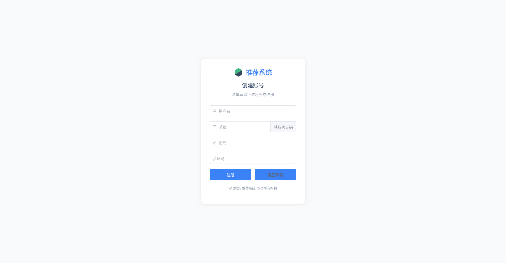 |

### 系统管理

| 功能     | 截图                                        |
| -------- | ------------------------------------------- |
| 控制台   | 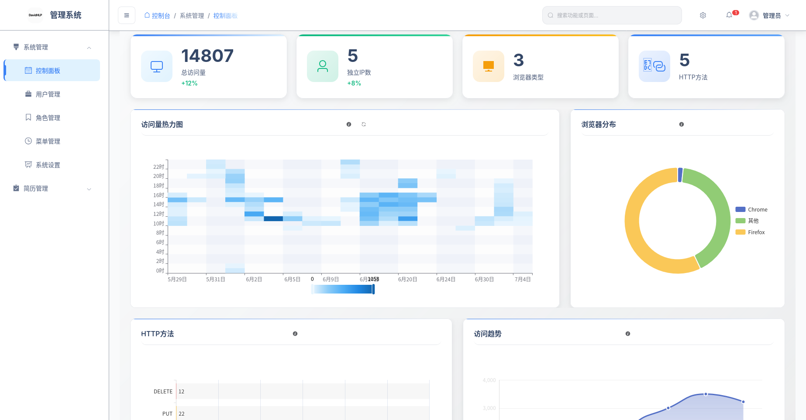   |
| 用户管理 | 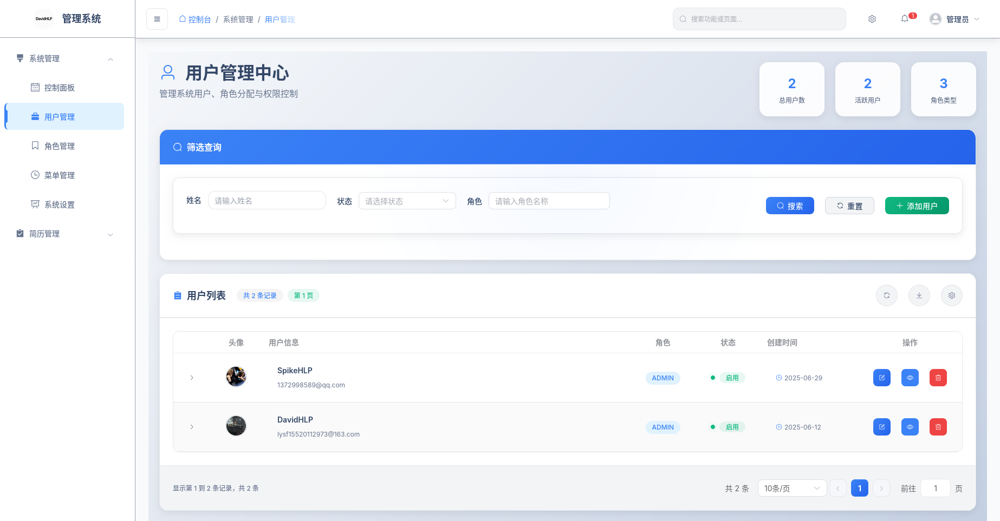 |
| 角色管理 | 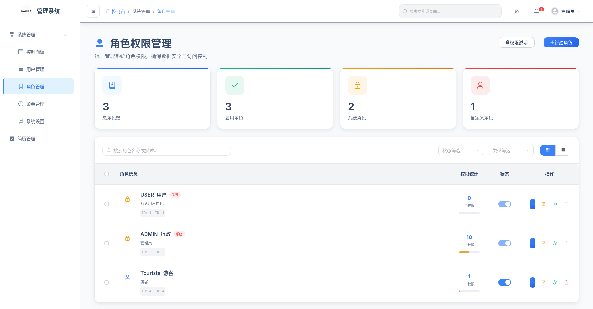 |
| 权限分配 | 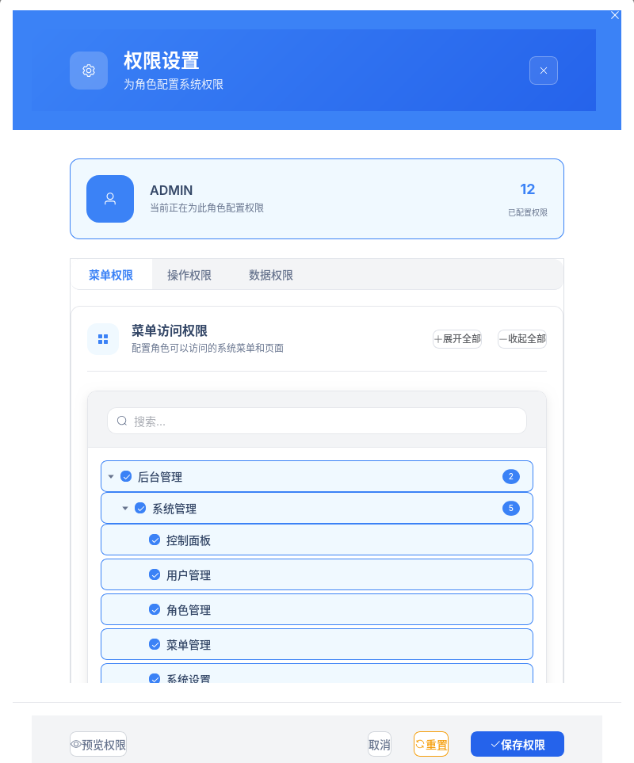 |
| 菜单管理 | 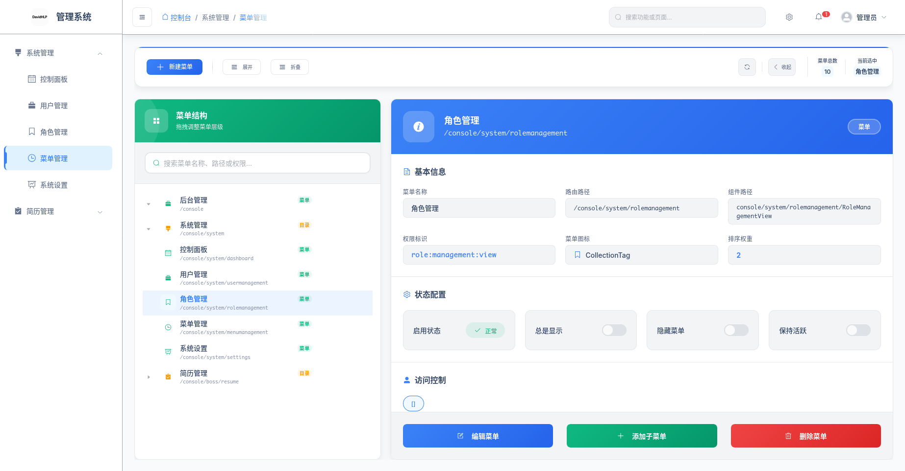 |
| 菜单编辑 | 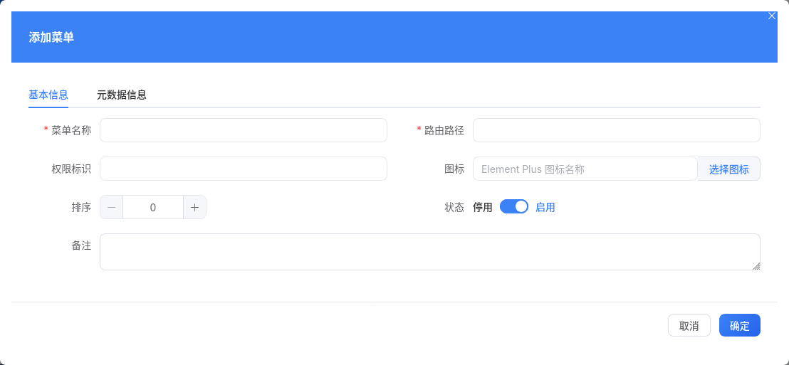 |

### 核心功能

| 功能     | 截图                                        |
| -------- | ------------------------------------------- |
| 简历编辑 | 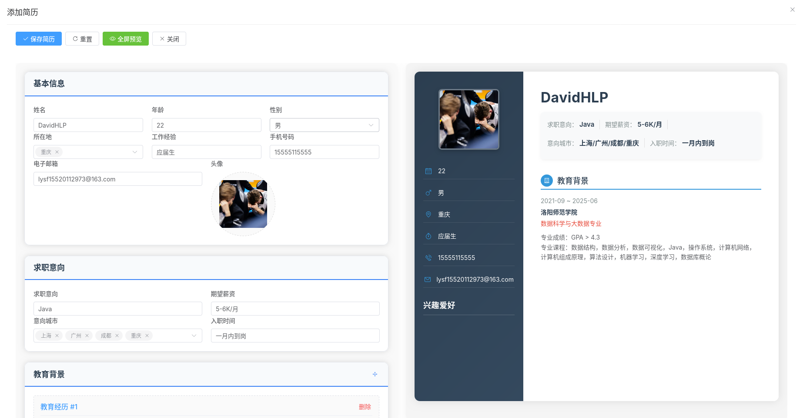 |
| 简历列表 | 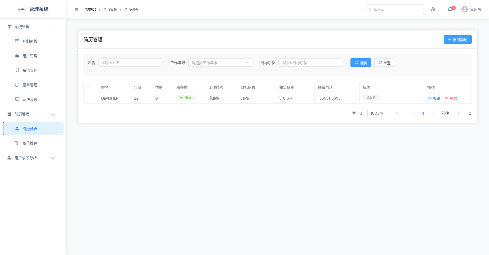 |
| 简历分析 | 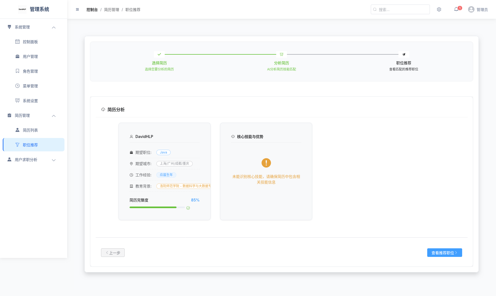 |
| 薪资分析 | 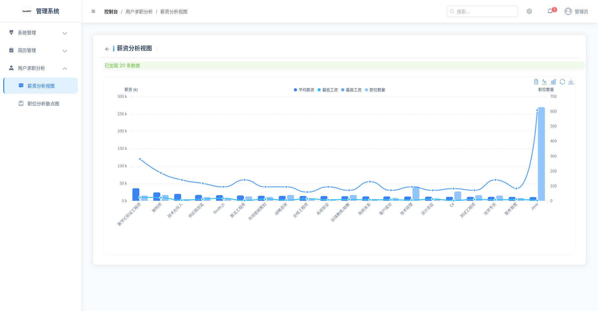 |
| 职位分析 | 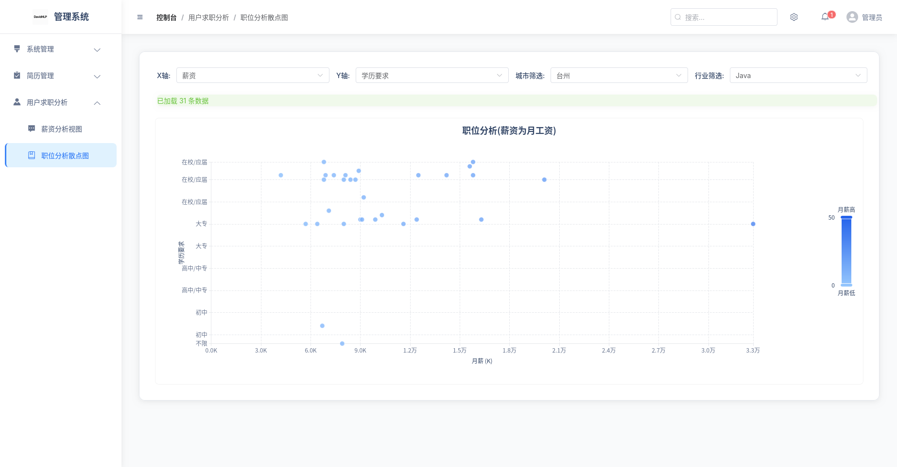 |

## 📅 项目计划

### ✅ 已完成功能

- [x] **基础权限控制与用户管理**：完整的 RBAC 权限控制系统
- [x] **基础数据管理**：职位、行业、地区等基础数据维护
- [x] **简历管理**：支持简历的增删改查与智能分析
- [x] **薪资分析**：多维度的薪资数据统计与可视化
- [x] **职位分析**：职位需求趋势与技能要求分析

### 🎯 求职者功能规划

- [ ] **智能简历优化**：基于目标职位自动优化简历内容
- [ ] **AI 面试模拟**：智能模拟面试场景，提供实时反馈
- [ ] **职业路径规划**：基于用户画像的个性化职业发展建议
- [ ] **薪资谈判助手**：提供市场薪资数据支持
- [ ] **技能提升建议**：根据职位需求推荐学习路径

### 🏢 企业功能规划

- [ ] **人才画像**：多维度构建候选人画像
- [ ] **智能匹配**：AI 驱动的职位与人才智能匹配
- [ ] **招聘流程管理**：端到端招聘流程管理
- [ ] **人才库建设**：企业专属人才资源池
- [ ] **市场薪酬报告**：行业薪酬数据分析报告

### 🚀 平台优化方向

- [ ] **移动端适配**：响应式设计，支持移动端访问
- [ ] **数据大屏**：实时数据可视化大屏展示
- [ ] **国际化支持**：多语言界面适配
- [ ] **第三方登录**：支持主流账号体系接入
- [ ] **数据导出**：支持多种格式的数据导出与报告生成
