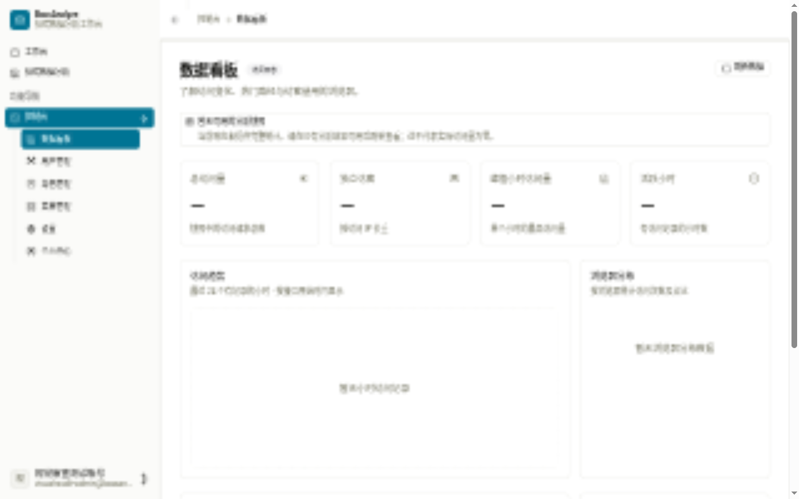
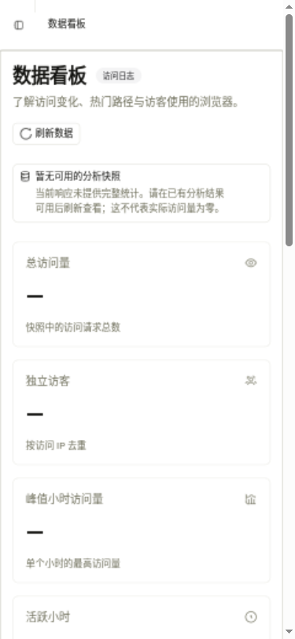
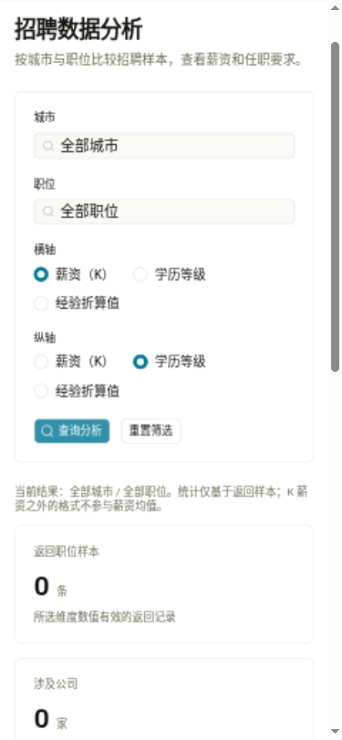

# 离线基础设施交付与验收 — 2026-11-08

总体状态：**部分完成，旧对象存储迁移受阻，PR 保持草稿。** 用户明确延期 AI；本轮没有改动 AI 生产代码、模型、依赖或调度，也没有迁移 Python 生产模块。

## 已实现和验证

| 范围 | 结果与证据界限 |
| --- | --- |
| 离线定位 | 可选 DB-IP MMDB，无 key/无库仍可完整启动；真实官方库 IPv4/IPv6 查询、真实 Spark 国家/坐标聚合已验证。缺库未知不造坐标，不启动下载。 |
| 可信代理 | Nitro request hook 在 routeRules 前清洗入站头；API 只信任显式 peer。构建产物隔离回归及真实 Nuxt→API 伪造头拒绝已验证。 |
| 数据库 | 本机现库已增量添加完整单列角色名唯一约束，重跑跳过；备份恢复、独立连接三类并发冲突与 API409分别验证，原角色和引用不变。无 token 迁移，无全库重建。 |
| RustFS | 固定1.0.4镜像digest，新独立卷、loopback19000/19001；真实应用SDK读写/预签名/复制对账、实际图片HTTP字节/中文空格键、跨用户403、SVG隔离、重启持久化均在随机合成桶验证。旧业务源未迁移，当前应用入口仍指向原存储。 |
| 招聘链路 | 固定SQL在JDBC有损布尔映射前按原值0筛选。全新隔离schema50行0/1/NULL/2/-7全部保留至验收结束，四接口只返回0十行，薪资4.5；原空库四接口通过8082/8080/5020且urllib/curl均200合法[]，无重复分帧。 |
| 看板无快照 | 缺snapshot三层204；只有明确204映射null，非法200/null/空对象仍报错。浏览器正确显示“暂无可用的分析快照”，指标—，无伪零、无日志重算/写snapshot/flush。 |

原错误及修复后的运行记录分别保留，未把旧500、非标准flags错误或重复chunked改写为历史通过。详细R1/R2/R3证据见[运行边界报告](final-runtime-boundaries-20261108.md)。数据库、定位与存储手册见同目录对应文档。

## 最终统一检查

整合代码HEAD b9c5e0129dac0faf693136d898721d00fb0d0bc0；本文件及截图属于随后的纯文档交付，不修改运行代码。

- Java17全backend reactor clean verify：65项，0失败/错误/跳过；官方MMDB用例显式执行。
- credential clean verify及offline clean verify：同组各65项，0失败/错误/跳过。
- frontend：66项通过，type-check与生产build通过。
- 独立Standards审查无确认问题；SPEC发现的代理P1、运行发现的二进制包装/JDBC/分帧/204问题均已修复并分别复核。最终边界独立复核无确认新增缺陷。
- 此处为本地检查，不冒称最终远程CI或生产验收；远程结果以PR当前head记录为准。

## 实际浏览器

本轮使用已有合成账号的新登录会话，真实5020/API链，无mock。1280px桌面与375×812模拟视口验证DB-IP署名和空快照，无水平溢出；招聘四接口200、实际查询展示空样本；UI注销返回/login且清令牌。自有incognito标签已关闭。

未做物理移动设备、读屏器、性能或视觉基线差异验收。空快照展示不是填充统计验收，登录不是新账号注册验收。

## 保留运行环境

- frontend http://127.0.0.1:5020、API8080、analytics8082、原crawler8081、Mongo/MySQL/Redis及新RustFS保持运行。
- 运行产物是稳定私有拷贝；API/analytics对应源c2a8b93，前端对应50e38be，与整合提交3f159b4/11e957c的相同代码对应，未把旧进程重标为新构建。
- 私有manifest `/home/david/.local/share/bossanalyze/local-dev/final-runtime-e6df9cf38b/manifest.json` 保存精确PID、starttime、配置与回退记录。私有环境、会话、备份与日志不得公开；本报告只列路径，不含凭据。
- 原数据卷/备份保留；合成夹具和隔离服务只清理本次创建者，保留恢复schema与证据。应用回退不删除已落地唯一索引。

## 未完成与风险

1. **旧MinIO源127.0.0.1:18988不可达、源数据/备份位置未知。** 没有原对象清单、复制/对账、恢复验证或最终入口切换证据，不能称迁移完成。已向用户请求源服务地址/目录/备份位置；不提供密钥。原存储入口保持不变，现有应用图片业务暂不能借新RustFS自动恢复。补齐源后继续独立迁移窗口、备份恢复和切换/回退验收。
2. **SMTP健康检查失败**：API aggregate health503（MailHealthIndicator），readiness200、登录/业务读取有效。未禁用检测、修邮件配置或发送邮件；不宣称全健康。
3. AI按用户要求延期，未调用；未合并PR或部署生产。

当前可检查代码和本机已运行能力，但整个规范的存储迁移部分仍未完成，保持草稿而非绕过验收门。
